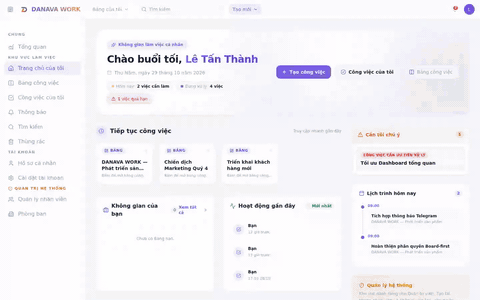
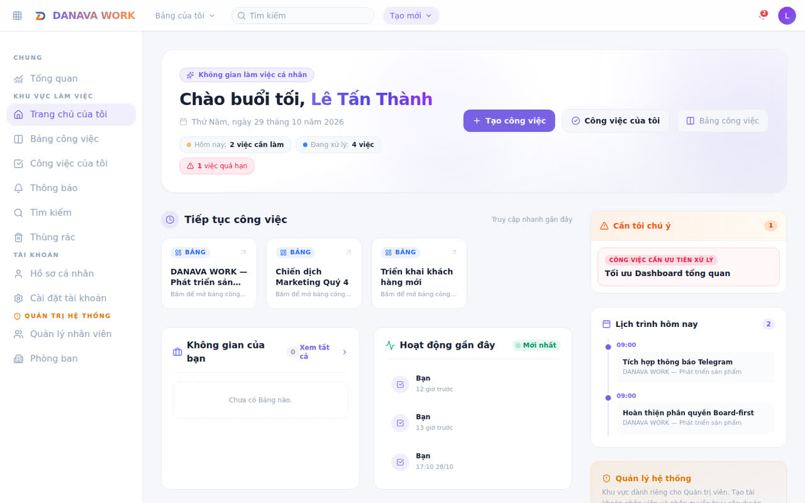
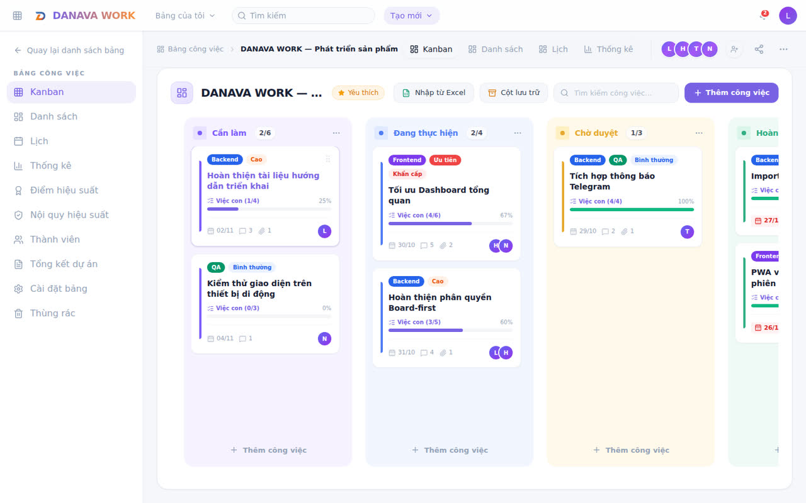
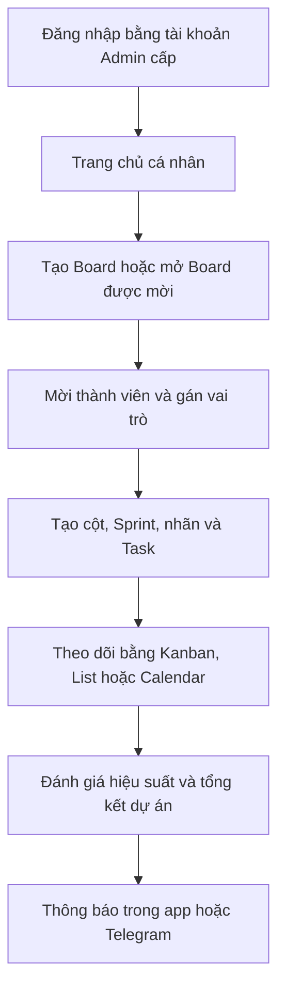
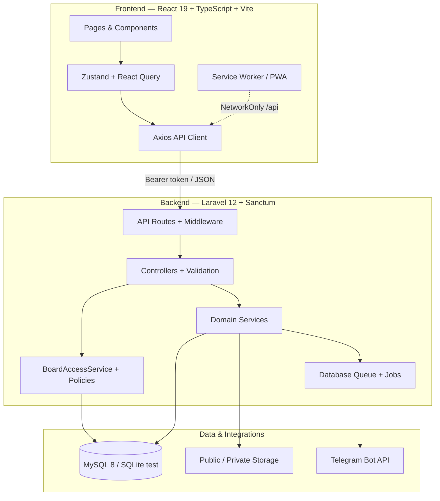
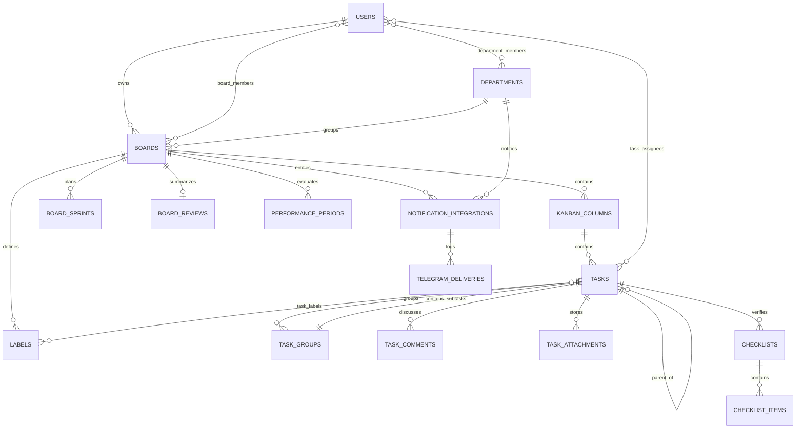

<div align="center">


# DANAVA WORK

### Nền tảng quản trị công việc, dự án và hiệu suất dành cho đội ngũ DANAVA

[](https://github.com/HungNguyen3205/DANAVA-TRELLO/actions/workflows/ci.yml)


**Board-first · Phân quyền chặt chẽ · Kanban/List/Calendar · Hiệu suất · Telegram · PWA**

[Xem demo](#-video-giao-diện) · [Tính năng](#-tính-năng-chính) · [Kiến trúc](#-kiến-trúc-hệ-thống) · [Dữ liệu](#-sơ-đồ-dữ-liệu) · [Cài đặt](#-cài-đặt-phát-triển) · [Deploy](#-triển-khai-production)

</div>

---

## 🎬 Video giao diện

> Video được quay từ frontend hiện tại trên nhánh `main`; dữ liệu trong video là dữ liệu minh họa cục bộ, không chứa tài khoản hoặc dữ liệu production.

<div align="center">

[](docs/media/danava-work-demo.mp4)

**[▶ Xem video đầy đủ 21 giây (MP4)](docs/media/danava-work-demo.mp4)**

</div>

<details>
<summary><strong>Ảnh giao diện tĩnh</strong></summary>

### Trang chủ cá nhân



### Bảng Kanban



</details>

---

## DANAVA WORK là gì?

DANAVA WORK là hệ thống quản trị công việc nội bộ theo mô hình **Board-first**. Mỗi bảng là một không gian cộng tác độc lập, có chủ sở hữu, thành viên và vai trò riêng. Người dùng theo dõi công việc bằng Kanban, danh sách hoặc lịch; quản lý task cha/con, phân công nhiều người, sprint, nhãn, file, thảo luận, đánh giá chất lượng và hiệu suất.

Hệ thống gồm hai lớp quyền tách biệt:

- **Quyền hệ thống** quản lý tài khoản nhân viên và phòng ban.
- **Quyền Board** quản lý dữ liệu dự án; chỉ `owner_id` và `board_members` cấp quyền truy cập.

System Admin không tự động nhìn thấy Board riêng tư nếu chưa được mời. Workspace cũ được giữ để tương thích dữ liệu, nhưng không phải nguồn cấp quyền Board trong kiến trúc mới.

---

## ✨ Tính năng chính

### Quản lý công việc

- Kanban kéo thả với fractional ordering, WIP limit và lưu trữ cột.
- Chế độ List và Calendar đồng bộ chung một nguồn dữ liệu.
- Task cha, task con, nhóm công việc và checklist.
- Nhiều người thực hiện; chia tỷ lệ đóng góp tổng cộng 100%.
- Mức độ ưu tiên, độ phức tạp, tiến độ, ngày bắt đầu và hạn hoàn thành.
- Sprint, nhãn màu, bình luận, file đính kèm và lịch sử hoạt động.
- Import Excel theo luồng preview → xác nhận → báo cáo lỗi.
- Thùng rác, khôi phục và xóa vĩnh viễn theo quyền.

### Điều hành và báo cáo

- Dashboard cá nhân, công việc của tôi và tìm kiếm trong phạm vi được phép.
- Thống kê khối lượng công việc theo thành viên.
- Chính sách hiệu suất, kỳ đánh giá, tính điểm, công bố và khóa kỳ.
- Tổng kết dự án với quy trình soạn thảo, công bố và khóa nội dung.
- Quản lý nhân viên, nhiều phòng ban, trưởng phòng và chức danh theo phòng ban.

### Cộng tác và thông báo

- Mời thành viên vào Board với vai trò Owner/Admin/Member.
- Thông báo trong ứng dụng và bộ đếm chưa đọc.
- Telegram ở cấp Board hoặc phòng ban, xử lý qua queue và có lịch sử giao nhận.
- Liên kết mô tả/bình luận được mở an toàn trong tab mới.

### Trải nghiệm sản phẩm

- Giao diện responsive cho desktop, tablet và mobile.
- Chế độ sáng/tối, trạng thái offline và thông báo cập nhật phiên bản.
- PWA cài đặt được; API dùng `NetworkOnly` để tránh dữ liệu tài khoản bị cache.
- URL Board công khai dạng `/{public_id}/kanban`, không lộ ID tuần tự trên giao diện.

---

## 🧭 Luồng sử dụng



---

## 🏗 Kiến trúc hệ thống



### Ngăn xếp công nghệ

| Lớp | Công nghệ | Vai trò |
|---|---|---|
| Frontend | React 19, TypeScript 6, Vite 8 | SPA, routing và production build |
| UI | Tailwind CSS, Radix UI, Lucide | Component, theme và responsive |
| State/Data | Zustand, React Query, Axios | Trạng thái client, cache và API |
| Kanban | dnd-kit | Kéo thả cột và công việc |
| Calendar/Charts | React Big Calendar, Recharts | Lịch và báo cáo trực quan |
| Backend | PHP 8.2, Laravel 12 | REST API và nghiệp vụ |
| Authentication | Laravel Sanctum | Token authentication |
| Database | MySQL 8 production, SQLite test | Dữ liệu quan hệ và CI nhanh |
| File/Excel | Laravel Storage, PhpSpreadsheet | Upload và import/export |
| Background jobs | Laravel database queue | Telegram và tác vụ bất đồng bộ |
| PWA | Vite PWA, Workbox | Cài ứng dụng và cập nhật phiên bản |
| Quality gate | PHPUnit, Vitest, Oxlint, TypeScript | Test, lint, build và kiểm tra MySQL |

### Cấu trúc thư mục

```text
DANAVA-TRELLO/
├── backend/
│   ├── app/
│   │   ├── Console/Commands/     # Audit dữ liệu, dọn thùng rác, tác vụ định kỳ
│   │   ├── Http/Controllers/     # REST controllers
│   │   ├── Http/Middleware/      # Auth, System Admin, bắt đổi mật khẩu
│   │   ├── Http/Requests/        # Validation request
│   │   ├── Jobs/                 # Telegram queue jobs
│   │   ├── Models/               # Eloquent models
│   │   ├── Policies/             # Authorization policies
│   │   └── Services/             # Quyền Board, hiệu suất, Excel, Telegram
│   ├── database/
│   │   ├── migrations/           # Lược đồ và nâng cấp dữ liệu
│   │   ├── factories/            # Test factories
│   │   └── seeders/              # Dữ liệu phát triển/demo
│   ├── routes/api.php            # API entry point
│   └── tests/                     # PHPUnit Feature + Unit tests
├── frontend/
│   ├── public/                    # Logo và PWA icons
│   └── src/
│       ├── components/            # Layout, Kanban, modal và UI dùng chung
│       ├── lib/api/               # API modules
│       ├── pages/                 # Màn hình sản phẩm
│       ├── store/                 # Zustand stores
│       └── types/                 # TypeScript domain types
├── docs/
│   ├── media/                     # Video và ảnh README
│   └── CPANEL_PRODUCTION_DEPLOYMENT.md
├── .github/workflows/ci.yml       # CI SQLite + MySQL 8 + frontend
└── README.md
```

---

## 🗃 Sơ đồ dữ liệu

Sơ đồ dưới đây thể hiện các quan hệ nghiệp vụ chính. Các bảng kỹ thuật như cache, session, queue và personal access token được lược bỏ để dễ đọc.



### Nhóm dữ liệu

| Nhóm | Bảng/Model tiêu biểu | Mục đích |
|---|---|---|
| Tài khoản | `users`, `personal_access_tokens` | Nhân viên, trạng thái và xác thực |
| Tổ chức | `departments`, `department_members` | Nhiều phòng ban, chức danh, quản lý |
| Board | `boards`, `board_members`, `kanban_columns` | Không gian dự án và quyền truy cập |
| Công việc | `tasks`, `task_groups`, `task_assignees` | Task cha/con, nhóm việc, nhiều người thực hiện |
| Phân loại | `board_sprints`, `labels`, `task_labels` | Sprint và nhãn theo Board |
| Nội dung | `task_comments`, `task_attachments`, `checklists` | Trao đổi, file và tiêu chí hoàn thành |
| Đánh giá | `performance_*`, `board_reviews` | Hiệu suất và tổng kết dự án |
| Thông báo | `notifications`, `notification_integrations`, `telegram_deliveries` | In-app và Telegram |
| Theo dõi | `activity_logs` | Nhật ký hoạt động theo Board/Task |

---

## 🔐 Phân quyền và cách ly dữ liệu

Quyền Board được tập trung tại `BoardAccessService`, policy và kiểm tra backend. Việc ẩn nút trên frontend chỉ là lớp trải nghiệm, không thay thế authorization.

| Khả năng | Owner | Board Admin | Member | Outsider | System Admin chưa được mời |
|---|:---:|:---:|:---:|:---:|:---:|
| Xem Board và tài nguyên con | ✅ | ✅ | ✅ | ❌ | ❌ |
| Tạo/cập nhật công việc | ✅ | ✅ | ✅ | ❌ | ❌ |
| Quản lý cột, Sprint, nhãn | ✅ | ✅ | Theo nghiệp vụ | ❌ | ❌ |
| Quản lý thành viên | ✅ | ✅ | ❌ | ❌ | ❌ |
| Xóa hoặc hạ quyền Owner | ❌ | ❌ | ❌ | ❌ | ❌ |
| Chuyển quyền sở hữu | ✅ | ❌ | ❌ | ❌ | ❌ |
| Xóa Board | ✅ | ❌ | ❌ | ❌ | ❌ |
| Quản lý tài khoản/phòng ban | Theo role hệ thống | Theo role hệ thống | Theo role hệ thống | — | ✅ |

Các nguyên tắc quan trọng:

1. Board chỉ được nhìn thấy khi người dùng là `boards.owner_id` hoặc có bản ghi trong `board_members`.
2. System Admin không bypass quyền Board.
3. Cùng phòng ban hoặc Workspace cũ không tự động tạo quyền Board.
4. Tài nguyên con phải cùng Board; backend chặn thao tác chéo Board/IDOR.
5. Gỡ thành viên làm mất quyền truy cập ngay và xử lý assignment trong đúng phạm vi Board.
6. URL giao diện dùng `public_id`; API vẫn kiểm tra quyền với mọi ID nhận vào.

Test chấp nhận cách ly Board:

```text
backend/tests/Feature/BoardIsolationAcceptanceTest.php
```

---

## 🔌 API theo miền nghiệp vụ

Toàn bộ API được bảo vệ bởi Sanctum, trừ đăng nhập. Danh sách dưới đây là nhóm endpoint, không phải tài liệu OpenAPI đầy đủ.

| Miền | Endpoint tiêu biểu |
|---|---|
| Auth/Profile | `/api/login`, `/api/me`, `/api/account/*` |
| Board | `/api/boards`, `/api/boards/by-code/{publicId}` |
| Thành viên | `/api/boards/{board}/members` |
| Kanban | `/api/boards/{board}/kanban`, `/api/columns/*`, `/api/tasks/*/move` |
| Task/Subtask | `/api/tasks/*`, `/api/tasks/{task}/subtasks`, `/api/tasks/{task}/groups` |
| Sprint/Label | `/api/boards/{board}/sprints`, `/api/boards/{board}/labels` |
| File/Checklist | `/api/tasks/{task}/attachments`, `/api/tasks/{task}/checklists` |
| Excel | `/api/boards/{board}/tasks/import/*` |
| Dashboard | `/api/me/dashboard`, `/api/boards/{board}/dashboard/member-workload` |
| Hiệu suất | `/api/boards/{board}/performance/*` |
| Tổng kết | `/api/boards/{board}/review` |
| Telegram | `/api/boards/{board}/telegram`, `/api/admin/departments/{department}/telegram` |
| Quản trị | `/api/admin/employees`, `/api/admin/departments` |
| Thùng rác | `/api/trash/*` |

---

## 🚀 Cài đặt phát triển

### Yêu cầu

- PHP `8.2+` và Composer 2.
- Node.js `22+` và npm.
- SQLite cho phát triển nhanh hoặc MySQL `8.0` để gần production.
- Các PHP extension: `mbstring`, `xml`, `ctype`, `intl`, `pdo_sqlite`/`pdo_mysql`, `curl`, `zip`, `bcmath`.

### 1. Clone repository

```bash
git clone https://github.com/HungNguyen3205/DANAVA-TRELLO.git
cd DANAVA-TRELLO
```

### 2. Chạy backend

```bash
cd backend
composer install
cp .env.example .env
php artisan key:generate
touch database/database.sqlite
php artisan migrate
php artisan serve
```

Backend mặc định chạy tại `http://127.0.0.1:8000`.

> Không chạy seeder demo trên database production. Nếu cần dữ liệu mẫu ở môi trường cô lập, hãy cấu hình `DEFAULT_ADMIN_PASSWORD` và `DEFAULT_USER_PASSWORD` bằng giá trị riêng trước khi seed.

### 3. Chạy frontend

Mở terminal khác:

```bash
cd frontend
npm ci
npm run dev
```

Vite proxy `/api` sang `http://localhost:8000`. Có thể đặt `VITE_API_URL=/api` khi build production cùng domain.

### 4. Chạy queue

Mở terminal thứ ba:

```bash
cd backend
php artisan queue:work --queue=default --sleep=3 --tries=3 --timeout=120
```

---

## ⚙️ Biến môi trường quan trọng

```dotenv
APP_ENV=production
APP_DEBUG=false
APP_URL=https://your-domain.example

DB_CONNECTION=mysql
DB_HOST=127.0.0.1
DB_PORT=3306
DB_DATABASE=
DB_USERNAME=
DB_PASSWORD=

CACHE_STORE=database
SESSION_DRIVER=database
QUEUE_CONNECTION=database
FILESYSTEM_DISK=public

TELEGRAM_NOTIFICATIONS_ENABLED=false
TELEGRAM_BOT_TOKEN=
TELEGRAM_BOT_USERNAME=
```

Nguyên tắc cấu hình:

- Không commit `.env`, token, mật khẩu hoặc database dump có dữ liệu thật.
- Production phải dùng `APP_DEBUG=false` và HTTPS.
- Frontend và backend phải được build/deploy từ cùng một commit.
- Sau thay đổi queue code, chạy `php artisan queue:restart`.

---

## ✅ Kiểm thử và quality gate

### Backend

```bash
cd backend
php artisan config:clear
php artisan migrate:fresh --force
php artisan test
./vendor/bin/pint --test
```

### Frontend

```bash
cd frontend
npm ci
npm run lint
npx tsc --noEmit
npm run test
npm run build
```

### CI

`.github/workflows/ci.yml` chạy bốn quality gate:

1. Backend PHP 8.2 + SQLite.
2. Backend PHP 8.2 + MySQL 8.0.
3. Frontend Node 22: lint, TypeScript, Vitest và build.
4. Deploy Gate chỉ chạy khi ba job trên đều thành công.

Các nhóm test quan trọng bao phủ:

- Board isolation và authorization.
- Board-first architecture và chia sẻ Board.
- Vòng đời Kanban, task, subtask, task group và multi-assignee.
- WIP limit, Excel import, thùng rác và thông báo.
- Phòng ban, hiệu suất, tổng kết dự án và Telegram.
- Dashboard cá nhân và dashboard tổng quan.

---

## 📦 Triển khai production

Tài liệu cPanel đầy đủ:

**[docs/CPANEL_PRODUCTION_DEPLOYMENT.md](docs/CPANEL_PRODUCTION_DEPLOYMENT.md)**

Quy trình rút gọn:

```bash
# Backend
composer install --no-dev --prefer-dist --optimize-autoloader
php artisan migrate --force
php artisan storage:link
php artisan optimize:clear
php artisan config:cache
php artisan route:cache
php artisan view:cache

# Frontend
cd frontend
npm ci
npm run lint
npm run test
npm run build
```

Sau deploy cần kiểm tra:

- Queue worker và scheduler hoạt động.
- `/api/*` đi vào Laravel; SPA routes trả `index.html` khi refresh.
- `public/storage` đúng quyền và symlink.
- Service Worker nhận bundle mới, không giữ chunk cũ.
- Smoke test đăng nhập, tạo Board, mời/gỡ thành viên, tạo/kéo Task, upload file và thông báo.
- Có backup database, file upload, `.env` và phương án rollback trước khi migrate.

---

## 🧰 Lệnh vận hành hữu ích

```bash
# Kiểm tra dữ liệu Board; chạy dry-run trước khi sửa
php artisan board:audit-data --dry-run

# Kiểm tra task đến hạn
php artisan notifications:check-due-tasks

# Nâng một tài khoản đã tồn tại thành System Admin
php artisan make:admin user@example.com

# Khởi động lại queue sau release
php artisan queue:restart
```

Tên command và option có thể thay đổi theo phiên bản; dùng `php artisan list` và `php artisan help <command>` để xem cấu hình hiện tại.

---

## 🛡 Ghi chú bảo mật

- Public register được khóa; tài khoản do System Admin cấp.
- Đổi mật khẩu lần đầu và đổi mật khẩu thường là hai luồng riêng.
- File upload được kiểm tra quyền theo Task/Board; tên lưu trữ phải được sinh an toàn.
- Nội dung người dùng không được render bằng HTML chưa sanitize.
- Search, dashboard, file, Sprint, Label, Trash và Telegram đều phải giữ phạm vi Board.
- Không dựa vào ID khó đoán để bảo mật; mọi endpoint vẫn phải authorize ở backend.
- Không ghi token, mật khẩu hoặc Telegram secret vào log.

Nếu phát hiện lỗ hổng, không công bố dữ liệu khai thác trong issue công khai. Hãy liên hệ đội ngũ DANAVA qua kênh nội bộ để xử lý có kiểm soát.

---

## 🗺 Trạng thái kiến trúc

- Luồng sản phẩm chính hiện là **Board-first**.
- Workspace legacy vẫn tồn tại để tương thích dữ liệu và URL cũ; không được dùng làm nguồn quyền Board.
- Department phục vụ quản trị nhân sự và Telegram theo cấu hình, không tự động cấp quyền Board.
- Production readiness phải dựa trên kết quả CI, migration MySQL và smoke test của đúng commit triển khai; README không thay thế biên bản release.

---

<div align="center">

### DANAVA WORK

**Một nơi để lập kế hoạch · phối hợp · theo dõi · đánh giá · hoàn thành**

Developed by **DANAVA Solutions**

</div>
